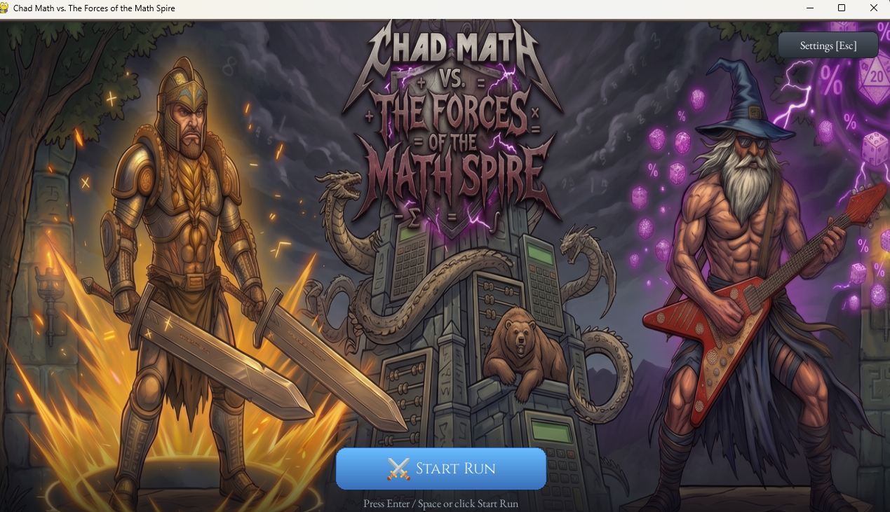

# Chad Math vs. The Forces of the Math Spire

*(internal/dev name: **Math Meme Spire**; build artifact name: **ChadMathSpire**
— all three refer to the same game, see "A note on naming" below)*

An original math/probability-themed roguelike deckbuilder, built with
Python + [pygame](https://www.pygame.org/), inspired by *Slay the Spire*.
Climb a 3-act spire as one of two characters, building a deck of
probability-flavored attacks and skills, fighting your way past regular
enemies, elites, and act bosses, and picking up relics that bend the odds
in your favor along the way.

Every card and enemy intent shows its real math — expected value, dice
odds, cost efficiency — right on the card or in the combat HUD, so the
game doubles as a (much more fun than usual) way to build intuition for
probability and expected value.



## First time playing?

1. Open the Windows game and click **How to Play** on the title screen. Use **Next** and **Back** at your own pace. **Start Run** takes you to character selection.
2. Choose **Math Warrior** for automatic Block each turn, or **Probability Wizard** to play with Rifts. Click a lit map room. Paths lead to a boss at the end of each of three acts.
3. In combat, read the enemy's **intent**, then hover over your cards. The gold circle is the Energy cost. Click cards to attack or defend. If a normal enemy hit is 10 and your total Block is 8, you lose 2 HP. Click **End Turn** to let the enemy act.
4. Next turn, Energy refills, old Block clears, and you normally draw five cards. Unused cards go to discard and cycle back when the draw pile empties. HP carries between fights. Win by beating the third boss before your HP reaches zero.

| Map room | What to do there |
|---|---|
| Combat / Elite | Win gold and choose a card, or skip it. Elites also offer a relic. |
| Treasure | Collect loot. Relics provide automatic bonuses. |
| Campfire | Heal about 30% of maximum HP or permanently upgrade an eligible card. |
| Shop | Buy cards, relics or a Tutoring Session, or pay to remove a card. |
| Wagering shrine | Read the stake and possible payout. You can walk away. |
| Boss | Clear the act. The first two bosses lead to a math quiz and rewards. |

**Reading the combat fields.** HP is health. Block absorbs ordinary damage. Strength adds attack damage. Weak halves outgoing damage, Vulnerable increases incoming damage by 50%, and Truncate lowers your rolls by 1, down to a minimum of 1. Status counters show duration. A piercing strike bypasses Block.

**Reading a die roll.** A card that deals `1d6 + 2` rolls a six-sided die and adds 2. Its range is 3–8 and its expected value is 5.5 before modifiers. Damage per Energy shows efficiency. Recoil is damage you can take yourself. Press **M** for the Math Inspector or **D** to inspect your deck.

## Characters

- **Math Warrior** — a calculated brute who relies primarily on blocking
  and skills, starting with the **Pi's Defense** relic (free block every
  turn).
- **Probability Wizard** — a fast-paced, high-variance caster with the
  **Abacus Charm** relic, which turns his lower base energy into extra
  energy every single turn.

## Tutoring Sessions and Rifts of Power

Both characters have three Tutoring Session slots. Click an occupied slot during combat to use it. Regular wins have a 30% drop chance and elite or boss wins have a 45% chance while there is space. The shop offers one session for 30 gold.

Using a session spends that item immediately. Unused items carry between fights. Hover over a belt icon to read its effect before clicking.

| Session | Effect |
|---|---|
| Cram Session | Gain 1d8 + 3 Block. |
| Pop Quiz | Deal 1d12 + 2 damage. |
| Study Group | Draw 1d3 cards. |
| Office Hours | Heal 1d6 + 2 HP. |
| Extra Credit / Caffeine Spike | Gain 1d2 / 1d3 Energy for this turn. |
| Study Buddy | Play your next card this combat for zero Energy. |
| Curved Grade | Activate before a lethal hit to survive once at 1 HP this combat. |

The Probability Wizard can channel Entropy for damage, Variance for block, or Convergence to store charge. Rifts tick at the start of the player turn. Play Rift Finale to evoke the oldest Rift. Channeling into a full row evokes it automatically. The Wizard starts each fight with two slots and zero Focus. Rift Compass adds a third slot. Negative Focus reduces Rift output to a minimum of zero.

## Running the game

### Windows: easiest option (download and play)

Download the [Windows game](https://github.com/Beerbuddie/chad_math/releases/download/v1.2.1/ChadMathSpire.exe) and double-click the executable. It includes Python, pygame, the artwork, fonts and soundtrack.

The repository includes a ready-to-run `ChadMathSpire.exe` in its top-level
folder. Download the repository as a ZIP, extract the entire ZIP, and
double-click `PLAY_GAME.bat` or `ChadMathSpire.exe`. Do not run either file
from inside the ZIP preview.
No Python, Pygame, or PyInstaller installation is required.

Keep the extracted folder together while playing. Windows may show a
SmartScreen warning because this educational executable is not code-signed;
choose **More info > Run anyway** only if you trust the download.

This build is **Windows-only**. macOS and Linux players should run the
game from source instead (see below) — it's cross-platform, since it's
just Python + pygame.

### From source (Windows, macOS, or Linux)

Requires **Python 3.9+** (any reasonably recent Python 3 works).

```bash
git clone https://github.com/Beerbuddie/chad_math.git
cd chad_math
python -m venv venv
venv\Scripts\activate        # Windows
source venv/bin/activate     # macOS / Linux

pip install -r requirements.txt
python polyhedral_spire.py
```

### Building the .exe yourself (Windows)

```bash
python -m venv venv
venv\Scripts\activate
pip install -r requirements-dev.txt
```

Then either double-click **`BUILD_EXE_FOR_DEVELOPERS.bat`**, or run:

```bash
pyinstaller ChadMathSpire.spec
```

The finished executable lands at `dist\ChadMathSpire.exe`. It bundles the
`assets/` folder into itself, so it's a single, self-contained file you
can hand to someone else.

### What to download

For most people, use **Code > Download ZIP**, extract it, and double-click
`PLAY_GAME.bat` or the root-level `ChadMathSpire.exe`. The repository ZIP
contains the source, artwork, documentation, and this verified Windows build.
The `BUILD_FROM_SOURCE.bat` / `BUILD_EXE_FOR_DEVELOPERS.bat` scripts are only for developers
who want to rebuild the executable; they are not needed to play the included
build.

## Controls

| Input | Action |
|---|---|
| Mouse click | Select a card, button, map node, or menu option |
| `Enter` / `Space` | Advance past the title screen |
| `Esc` | Pause menu (or back out of the deck viewer, if it's open) |
| `D` | Toggle the deck viewer |
| `M` | Toggle the Math Inspector during combat (live EV/odds breakdown); opens the deck viewer's audit stats from the rest site |
| `L` | Toggle the run log |
| `F11` or `Alt+Enter` | Toggle fullscreen |
| Digits, `+`, `-`, `Enter`, `Backspace` | Answer the equation quiz between acts |

## Music

“Power Chord Proof” is an original 20-second retro-rock loop with guitar, synth lead, bass and drums. It plays continuously across screens. Optional screen-specific MP3s can override it using the filenames in `MUSIC_FILES`.

## Project structure

```
polyhedral_spire.py        Game source (single module — see its own
                            docstring for the architecture notes)
test_math_meme_spire.py    Automated test suite (python -m unittest)
math_audit.py              Standalone script auditing every card/enemy's
                            math (EV formulas, dice odds) against the code
fuzz_playthrough.py        Headless fuzz-tester: runs many full
                            playthroughs with randomized input to catch
                            crashes
test_heuristic_playthrough.py
                            A scripted "reasonable player" playthrough test
_pygame_stub.py             A tiny in-process fake pygame, used only when
                            the real pygame isn't installed (e.g. this
                            sandbox); lets the test suite run headless
                            anywhere
assets/                    Fonts, icons, artwork, audio -- see
                            ASSETS_AND_CREDITS.md for what's licensed how
ChadMathSpire.spec         PyInstaller build config
PLAY_GAME.bat               Player launcher (no install or build required)
BUILD_EXE_FOR_DEVELOPERS.bat
                            Developer-only Windows .exe builder
requirements.txt           Runtime dependency (pygame)
requirements-dev.txt       + pyinstaller / pytest, for building/testing
```

## Running the tests

```bash
pip install -r requirements-dev.txt
python -m unittest test_math_meme_spire -v
```

The suite is fully headless (no window opens) and runs the same way
whether or not pygame is actually installed — see `_pygame_stub.py`'s
docstring. There's also a headless fuzz test that plays many full random
runs looking for crashes:

```bash
python fuzz_playthrough.py
```

## A note on naming

This project went through a rename mid-development (**Math Meme Spire** →
**Chad Math vs. The Forces of the Math Spire**, packaged as
**ChadMathSpire**). A few internal strings and the main module's filename
(`polyhedral_spire.py`) still reflect the earlier name — that's cosmetic
and left as-is rather than risk breaking anything by renaming files
mid-repo-cleanup.

## License

The source code is MIT-licensed — see `LICENSE`.

Everything under `assets/` (fonts, icons, AI-generated artwork, and any
music you add) ships under its own separate terms — see
`ASSETS_AND_CREDITS.md` before reusing or redistributing any of it.
